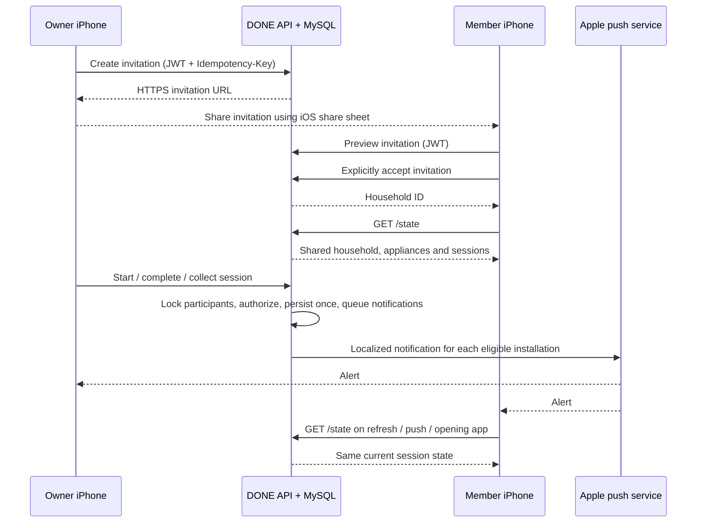

# Shared households and linked appliance steps

A household has one owner and up to nine additional members. Devices, programs and sessions remain attached to the household; sharing does not duplicate them or grant access to the owner's other households. Existing owner IDs and tenant foreign keys remain unchanged. MySQL migrations V2 and V3 add memberships, invitations, independent activity reads, device registrations and durable notification deliveries. V1 remains unchanged.

## User flow

On iPhone/iPad: Home → household selector → people icon → Invite someone → Share invitation. The recipient opens the HTTPS link, taps Open DONE, signs in if necessary, sees the owner's display name and explicitly joins. Pending links can be revoked. Invitations last seven days, are single-use and allow at most five outstanding invitations per household. Joining is serialized with household mutations; retrying the same join is safe, while a removed member cannot reuse a redeemed invitation.

HTTPS invitation pages disclose no household or member details. They open `done://household-invite/{token}`. Universal Links are not configured. An installed app is required for joining; the public page links to the App Store. Configure `PUBLIC_ORIGIN=https://done-appliance-f9pbg.ondigitalocean.app`, matching the iOS API origin. The invitation table stores only a SHA-256 token hash; the creator's idempotency receipt temporarily retains the returned invite URL, just like other command responses. Keep database access private and do not log invitation URLs.

Both users see the same running/finished/collected state and session history. Members can start, extend, cancel, complete and collect sessions, manage appliances/programs and create/revoke browser status links for that home. Only the owner can rename/delete a household, invite people or remove another member. Members can leave and mute that household's notifications. Household deletion still requires an empty household; account deletion removes the owner's shared households and their contents. Deleting a member's account preserves households owned by other people.

Activity read receipts are individual. Mutating requests require an Idempotency-Key UUID; access is checked before replaying a shared receipt, including retries after deletion. Simultaneous completion creates one completion event. Membership removal also removes that household's data from the next iOS snapshot. Previously issued public status links are separate viewing capabilities: removing a member does not revoke those links; revoke them explicitly or allow them to expire.

## DTOs

`GET /api/v1/households/{id}` returns viewer-specific role and notification preference:

```json
{"id":"<uuid>","name":"Our home","localizationKey":null,"applianceCount":2,"createdAt":"2026-10-11T10:00:00Z","version":0,"ownerId":"<owner-uuid>","role":"member","memberCount":2,"notificationsEnabled":true}
```

`GET /api/v1/households/{id}/members`:

```json
[{"userId":"<owner-uuid>","displayName":"Alex","role":"owner","joinedAt":"2026-10-11T10:00:00Z","notificationsEnabled":true},{"userId":"<member-uuid>","displayName":"Mara","role":"member","joinedAt":"2026-10-11T11:00:00Z","notificationsEnabled":true}]
```

`POST /api/v1/households/{id}/invitations` and authenticated `GET /api/v1/household-invitations/{token}`:

```json
{"id":"<invite-uuid>","householdId":"<household-uuid>","householdName":"Our home","localizationKey":null,"ownerName":"Alex","inviteUrl":"https://done-appliance-f9pbg.ondigitalocean.app/invite/<43-character-token>","expiresAt":"2026-10-18T10:00:00Z"}
```

`POST /api/v1/household-invitations/{token}/accept`:

```json
{"householdId":"<household-uuid>"}
```

`GET /api/v1/households/{id}/invitations` (owner only):

```json
[{"id":"<invite-uuid>","createdAt":"2026-10-11T10:00:00Z","expiresAt":"2026-10-18T10:00:00Z","used":false,"revoked":false}]
```

Additional endpoints:

| Method | Path | Permission / payload |
|---|---|---|
| DELETE | `/api/v1/households/{id}/invitations/{invite}` | Owner; Idempotency-Key |
| DELETE | `/api/v1/households/{id}/members/{member}` | Owner, or that member leaving; Idempotency-Key |
| PATCH | `/api/v1/households/{id}/membership` | Member; `{ "notificationsEnabled": false }`; Idempotency-Key |
| PUT | `/api/v1/devices/{installationId}` | Authenticated; `{ "token": "<APNs hex token>", "environment": "production" }`; returns `{ "enabled": true }` if remote delivery is enabled |
| DELETE | `/api/v1/devices/{installationId}` | That account's installation only |

Existing `/state`, appliance/program/session CRUD, history, activity, export, statistics and session sharing endpoints automatically apply household membership. `/state` is polled every 30 seconds while the app is active; APNs receipt/open requests a refresh. APNs does not guarantee background execution or delivery. Opening the app reloads the authoritative state. Unrelated public browser status links retain their five-minute refresh interval.



## APNs activation

Shared notifications cover timer start, confirmed completion, collection, cancellation, halfway, five minutes remaining, estimated end, overdue at 10/30/60/120/300 minutes, and collection reminders at 30/120 minutes. All remain estimates/manual confirmations. Notifications honor the device preference, the user's global preference and the member's household preference. Each user receives their selected language. Private-household timers keep local notifications. When the server confirms APNs is enabled, iOS suppresses duplicate local timer notifications for households with multiple members.

The delivery queue survives process restarts, leases each device delivery, retries transient failures independently, removes invalid tokens and checks current membership, preferences, authentication-session validity and timer generation before sending. Extending, backdating, canceling or collecting makes outdated deliveries ineligible. Alerts more than five minutes late are discarded. Device tokens are bound to an active login session; logout, logout-all and password reset prevent subsequent deliveries. Notification payloads include appliance names, so they may appear on the lock screen according to the user's system settings.

Set:

```properties
APNS_ENABLED=true
APNS_TEAM_ID=<Apple Developer team ID>
APNS_KEY_ID=<APNs key ID>
APNS_TOPIC=ro.done.app
APNS_PRIVATE_KEY_BASE64=<base64 of the entire private .p8 file>
```

Alternatively set `APNS_PRIVATE_KEY_PATH` to a readable `.p8` file. Docker Compose mounts `secrets/PushKey.p8` at `/run/secrets/PushKey.p8`. DigitalOcean App Platform can use `APNS_PRIVATE_KEY_BASE64` as an encrypted runtime environment variable. Keep key values out of Git and logs. APNs uses a separate permission/key from Sign in with Apple; ensure the key is authorized for the app topic. Enable Push Notifications for App ID `ro.done.app` and regenerate provisioning profiles. The app contains the APS entitlement and remote-notification background mode. Debug registrations use sandbox; TestFlight/App Store registrations use production. `APNS_ENABLED=false` is the safe default; no real notification was sent during tests.

## Manual washer → dryer suggestion

After a washer session is explicitly confirmed complete, iOS offers available dryers in that same home in a small dismissible card. A running dryer or one waiting to be emptied is excluded. Tapping a dryer opens its normal program setup; the user must tap Start timer. No appliance is controlled, no cycle starts automatically, and the washer is not automatically marked collected. The suggestion is computed locally from server-backed state and needs no new backend endpoint. No suggestion is made for unrelated device types.

## Validation

106 backend tests (82 API e2e + 24 security/Apple/APNs/configuration tests) passed on isolated MySQL, including membership isolation, single-use and concurrent redemption, revocation/replay, simultaneous completion, independent reads/preferences, owner/member account deletion, shared public status links, APNs retries, invalid tokens and logout. 107 Swift core tests and iOS/watchOS simulator builds verify model/deep-link compatibility and the optional dryer flow. Real APNs delivery requires the production configuration and an entitled physical-device/TestFlight build.
